# GUILIU 归流

[简体中文](README.md) | [日本語](README.ja.md) | **English**

**Organizes your financial records automatically, explains every change, and keeps telling you how far you are from your goals.**

GUILIU is an AI personal finance workspace that runs on your own computer. It gathers spending automatically from bank notification emails, receipt photos and Alipay / WeChat Pay statements, and turns it into a trustworthy ledger. Report-style pages and an analytical Agent then show you where the money went, how this month differs from last month, and how far you are from your savings goals.

GUILIU takes care of day-to-day entry, categorization and duplicate checks; you only handle the few exceptions that need your confirmation.

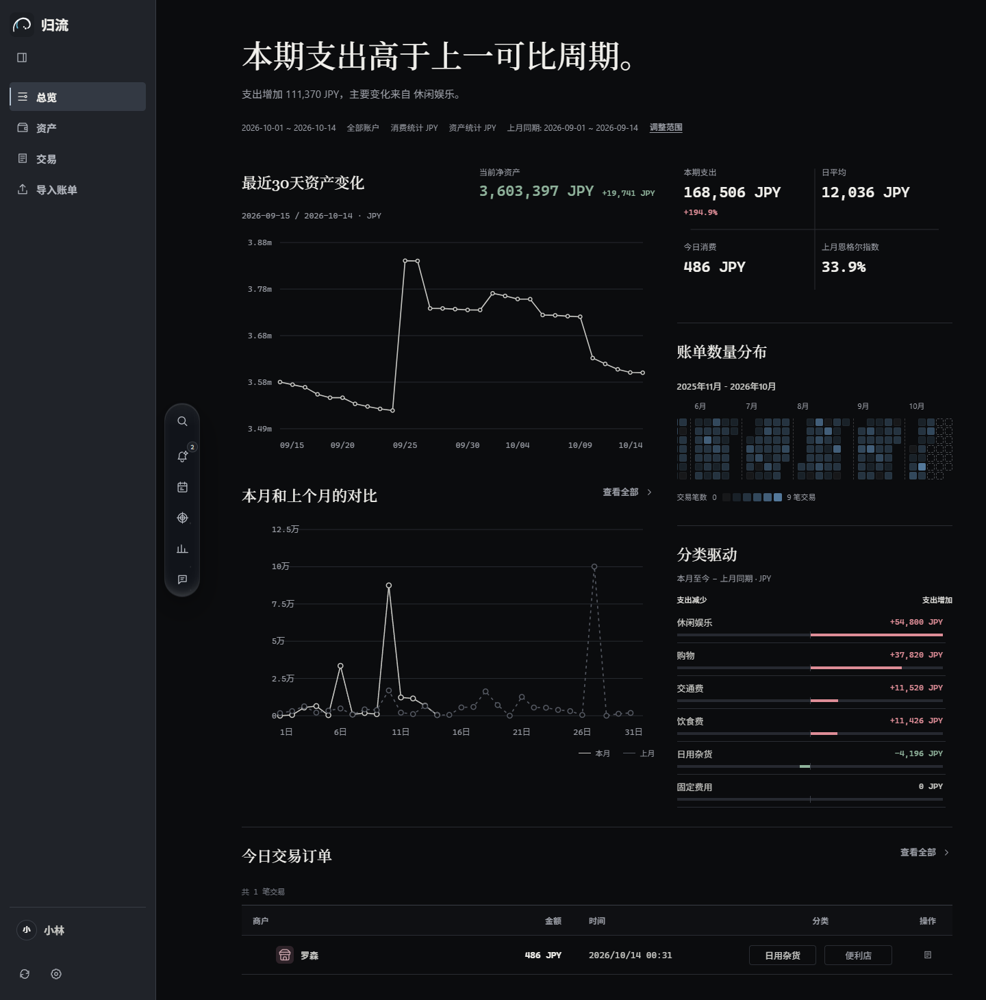

> The accounts, transactions and conversations in the screenshots are fictional demo data from an isolated local copy of 0.1.0-rc.15. The screenshots show the Chinese interface; GUILIU also runs in Japanese and English.

## How bills flow in

- **Bank notification emails**: connect Gmail or NetEase 163 Mail (both can be connected). GUILIU reads new mail every minute, extracts merchant, amount, currency and time with rules and a large language model, then categorizes, deduplicates and records it. Recognition rules are generated per sender automatically, with no built-in list of banks, and regenerated when a format changes.
- **Receipts and payment screenshots**: send them to a connected mailbox. When an image belongs to an existing bank charge, it becomes that bill's item details instead of a second record; otherwise it is recorded as a new purchase.
- **Statement files**: Alipay and WeChat Pay statements and bank exports (CSV / Excel) can be imported in bulk, with a preview before anything is written.
- **Detail enrichment (ADR)**: what did a bank charge actually buy? GUILIU looks for evidence in emails and receipts and attaches the item details under the original bill.
- Switching how Gmail is connected (Google sign-in or an app password) does not make old mail look new; mail processed before is recognized. When Gmail stops accepting the saved credential, the sidebar and Settings ask you to reconnect.

## Pages

### Overview

Opens as a financial briefing: a one-sentence conclusion; spending this period, the daily average, today's spending and last month's Engel coefficient; asset change over the last 30 days; this month against last month day by day; a full-year heatmap of bills; and the categories that pushed spending up or down. Date range, accounts and the main currency (JPY / CNY) can be changed at any time.

### Insights

Explains the change first, then the evidence: month to date against the same days last month, the daily trend, category drivers and merchant drivers, followed by monthly spending history and the transactions with the largest effect.

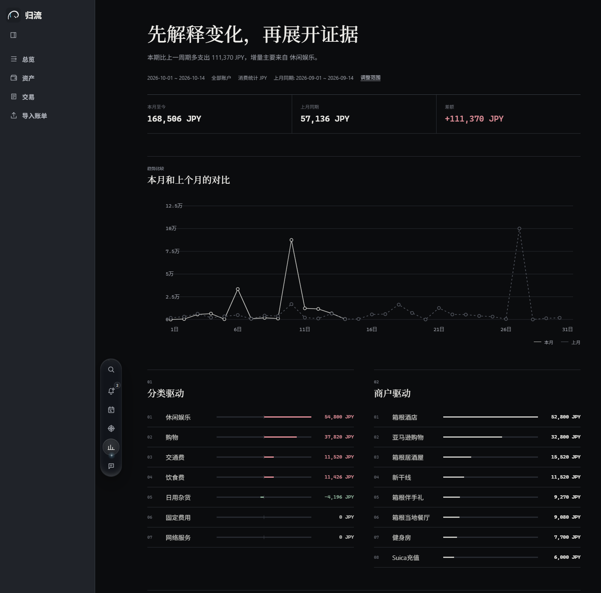

### Transactions

Every bill in one table: search by merchant, filter by ID, category and date, sort by amount or time, with category icons and smooth scrolling through long lists. Open a bill to see its time, amount, account, category and enriched item details, and edit it directly. With correction mode on, changing a category also corrects that merchant's past bills and its category memory.

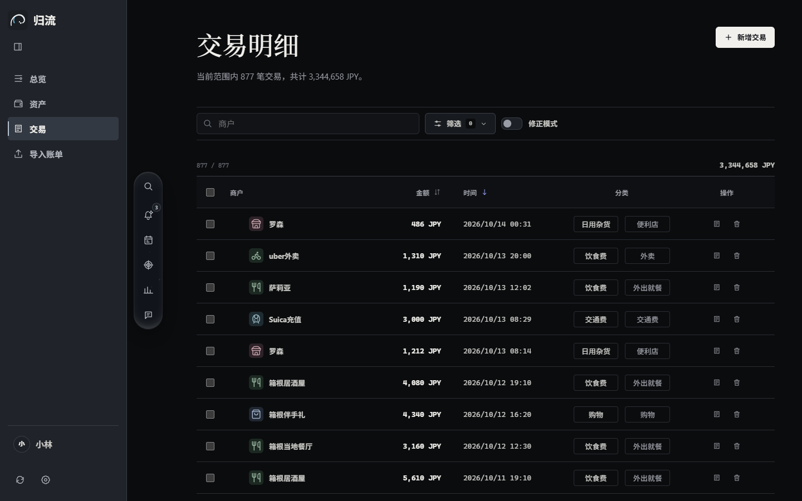

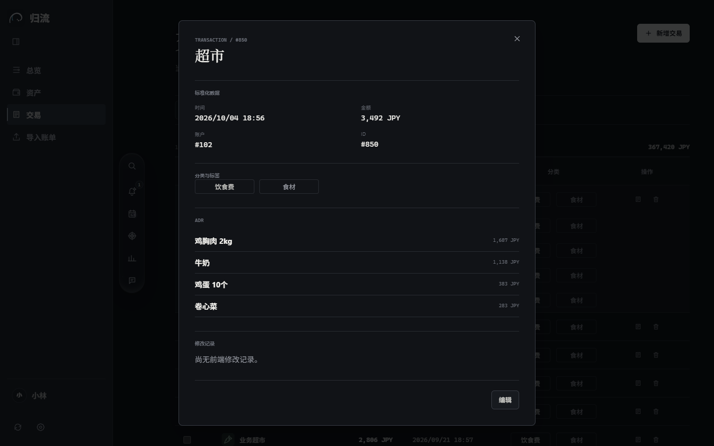

### Assets

Bank, cash, e-wallet, credit and other accounts together: net worth, total assets and debts, assets over time, each account's balance in its own currency and converted, and asset composition. Japanese yen and Chinese yuan are converted at the day's rate. Record income and calibrate balances; credit cards are kept as a credit limit plus the amount owed, with optional monthly automatic repayment.

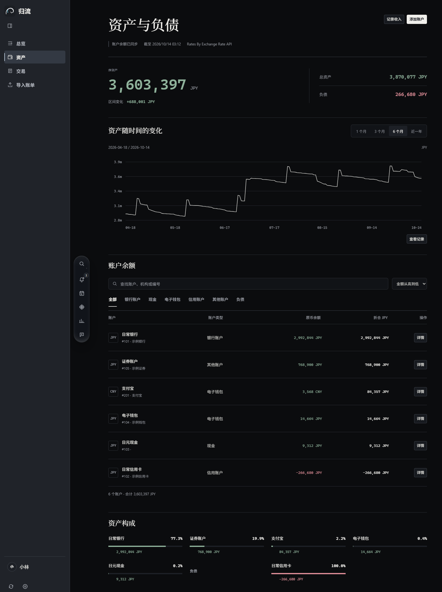

### Import statements

Drop in an Alipay or WeChat Pay statement or a bank export and choose the account. GUILIU shows what it recognized first: filter by state, income or expense, payment method, date and keyword, edit merchants and categories row by row, and only the ticked rows are written. Importing the same statement into another account skips the rows already imported.

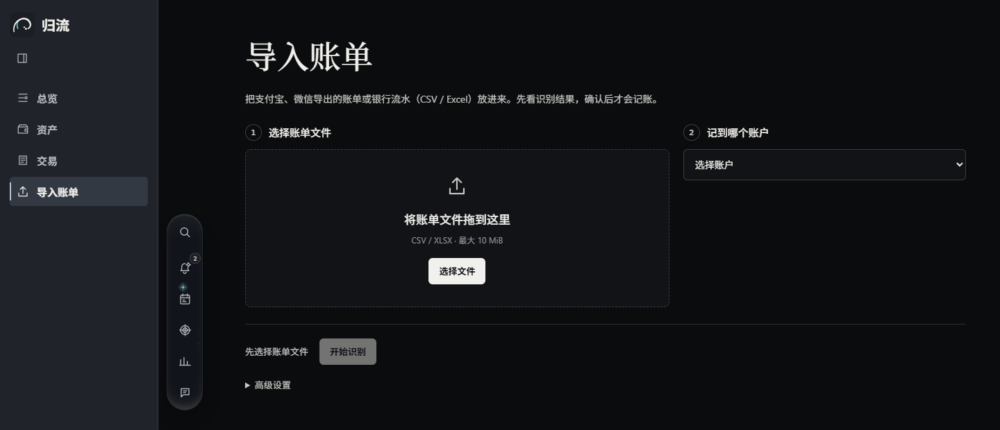

### Goals

Set a target and a monthly contribution for savings or investments, link accounts, record a contribution or withdrawal, and follow the progress, actual records against the plan, and the expected completion date. The Agent can draft a plan for you; it is saved only after you confirm it.

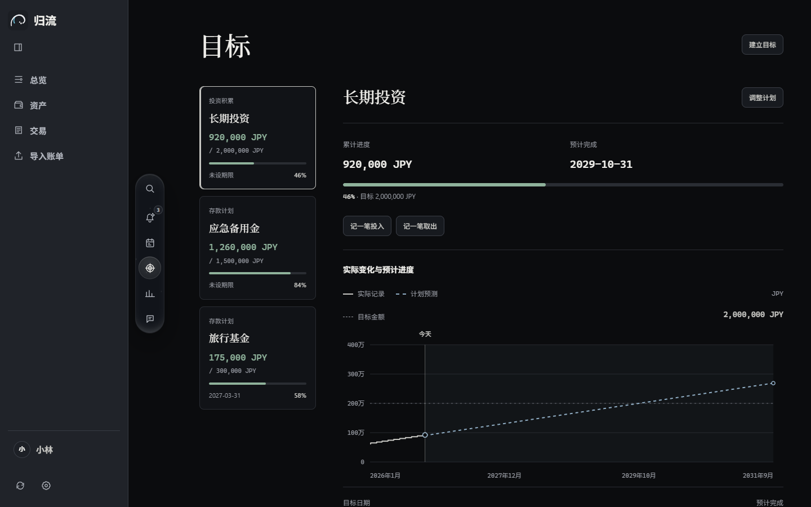

### Agent chat and canvas

Ask in natural language, for example "why did I spend more this month than last month?" The Agent queries your ledger and answers with a conclusion, key figures and the related bills; when useful it builds a chart report on the canvas: metrics, the daily trend, category comparisons and a detail table. Conversations continue across turns and sessions, can search the web, and gradually learn your preferences; the ID you set in Settings is what the AI calls you.

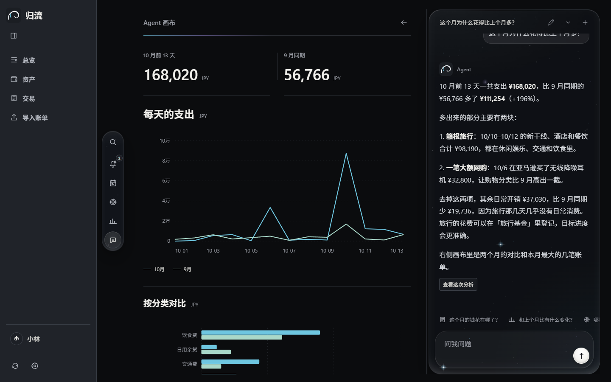

### Agent Notices

What the Agent finds on its own collects here, as analysis, anomalies and items that need your confirmation, each with its bills and data period. An item that needs confirmation can be marked confirmed (and taken back), opened in its bills, or answered in the chat.

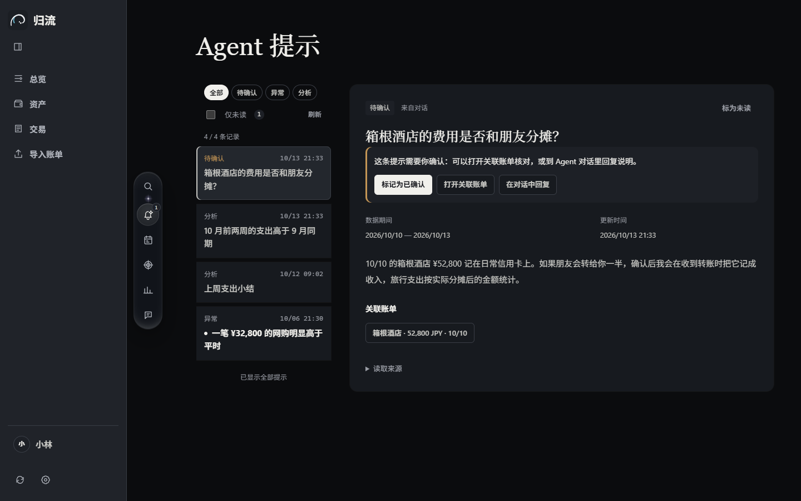

### Automated tasks

Describe in one sentence what you want to know regularly, choose a schedule (daily, weekly or manual), and the Agent runs it on time and posts the result to Agent Notices. Every task keeps its run history and can be paused or run at once.

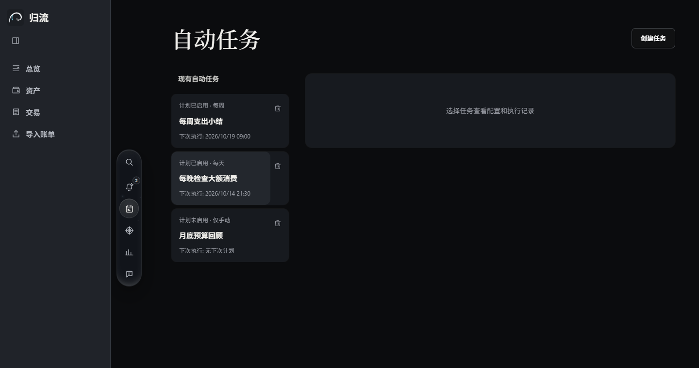

### Settings

Settings as cards, ordered by what people change most: profile (avatar and ID), data scope, mailboxes (Gmail / 163, with one-click reconnect when a connection stops working), appearance, version and updates, full mail import (can be stopped at any time) and runtime settings; rarely used connection and developer options are folded under Advanced.

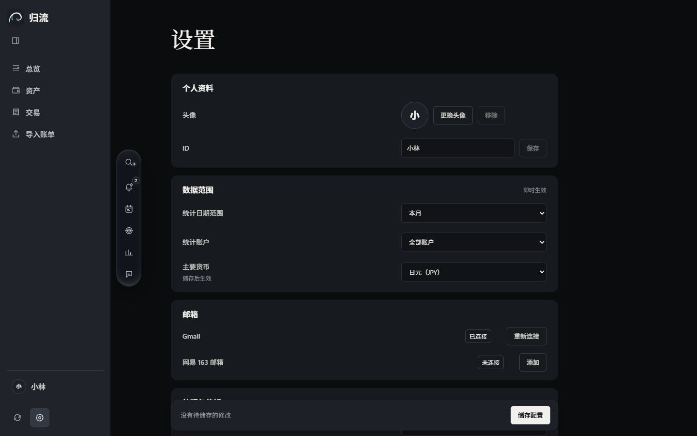

Also: Chinese, Japanese and English interfaces, light and dark themes, and a one-click switch for the red / green gain and loss colors.

## Your data stays on your computer

- All three services listen only on the local address. The ledger, vector database, chat history, credentials and logs are stored in `.runtime/` inside the program folder. A browser must be paired with this computer before it can connect; the launcher pairs it automatically.
- Mail is only read: nothing is sent, deleted or marked as read. The download connects Gmail with an app password (SSL IMAP); with your own Google OAuth app, Google sign-in (read-only access) also works. 163 Mail uses an IMAP authorization code.
- Steps that use external services: reading mail (Google / NetEase), information extraction and chat (Qwen), text embeddings (OpenAI), the Agent's web search, exchange rates (ExchangeRate-API, Frankfurter) and the update check (GitHub). The relevant email and receipt content is sent to the model services you configure, and those providers bill you for usage.
- Online updates and their update information are signature-checked; your data is backed up before the switch, and the previous version comes back automatically if the new one does not start.
- GUILIU is meant for one person on one computer. Do not expose its services to your local network or the internet.

## Download and use

**[Download the latest version](https://github.com/rhinoqvq/GuiLiu/releases/latest)** (Windows 10 / 11, 64-bit)

1. On that page, download `GUILIU-<version>-win-x64.zip`. The portable build includes Python 3.13, Node 22 and all dependencies, so nothing else needs to be installed.
2. Extract the whole archive to a folder you can write to (such as the desktop) and double-click `start_windows.cmd`. The launcher picks free ports and opens your browser. The black window is GUILIU itself; keep it open while you use it.
3. On first use, follow the setup pages: configure and test the APIs → connect Gmail / 163 → build the mail index → identify bank senders → confirm accounts → set the receipt sender address → finish.

You need:

- a Qwen API key from Alibaba Cloud Model Studio (DashScope) and an OpenAI API key;
- a Gmail or NetEase 163 mailbox. For Gmail, turn on 2-Step Verification and create a 16-character app password; for 163, turn on IMAP and get an authorization code. The setup pages guide you step by step.

Inside the extracted package, `README.md` is the user guide and `DEPLOYMENT.md` covers deployment and operations (both in Chinese).

Mail sync, detail enrichment and automated tasks are on by default and start only after setup is complete; mail sync can be turned off on the settings page. Later versions install with one click from Settings → Version and updates, or from the update entry at the bottom of the sidebar.

## Repository layout

| Path | Contents |
| --- | --- |
| `frontend/` | Plain HTML / CSS / JavaScript interface and a Node.js local server (static files, local pairing, same-origin proxy). No build step and no `npm install` |
| `backend/` | Python / FastAPI: mail access (Gmail API, IMAP), the daily processing loop, rule extraction, statement import, ledger and asset calculations, the setup flow, online updates; SQLite storage |
| `agent/` | Python / FastAPI: LLM calls (Qwen), embeddings (OpenAI) and the LanceDB vector store, tool execution, receipt recognition, categorization, detail enrichment, plans, automated tasks and Agent Notices |
| Root | Unified launcher `run.py` (starts all three services, picks free ports, pairs the browser, stops everything together), smoke test `smoke.py`, dependency lists `requirements.txt` and `constraints.txt`, deployment guide `DEPLOYMENT.md` |
| `release/` | Package build scripts `build.py` and `portable.py`, the launcher `launch.py`, runtime list `RUNTIMES.json`, in-package guide `README.package.md`; `release/windows/` holds the Windows start / stop / install scripts, and `release/macos/` the installer for an unsigned Apple silicon package built locally (not offered for download) |
| `docs/screenshots/` | The screenshots on this page |

The three services authenticate each other with their own credentials; the browser never receives long-lived keys.

## Run from source

Requires Python 3.13 and Node.js 22 or later.

```powershell
python -m venv .venv
.\.venv\Scripts\python.exe -m pip install -r requirements.txt
.\.venv\Scripts\python.exe run.py serve
```

The launcher starts the frontend, backend and Agent together, picks free ports (3000 / 8001 / 8000 by default, moving on to the next free port when one is busy) and opens your browser to pair. Runtime data goes to `.runtime/`; do not commit it to Git. For debugging, `--frontend-port`, `--backend-port` and `--agent-port` pin the ports. If you use a Google sign-in client of the "Web application" type, the backend port must match the redirect URI registered in the Google Cloud console. A source checkout does not update online; pull new versions with Git.

## Status

0.1 release candidate: the core bookkeeping, search, asset, goal and Agent analysis features are usable.

- Fully verified on Windows only so far.
- Text embeddings currently use OpenAI; supported currencies are currently Japanese yen and Chinese yuan.
- Some bank emails do not state a time zone; those are interpreted as Japan time.

## License

The original code is released under the MIT License, © 2026 rhinoqvq; see [LICENSE](LICENSE). Third-party code and assets keep their own licenses; see [THIRD_PARTY_NOTICES.md](THIRD_PARTY_NOTICES.md):

- [DDGS](https://github.com/deedy5/ddgs) (MIT): web search
- [TanStack Virtual](https://github.com/TanStack/virtual) (MIT): virtual scrolling for long lists
- [Lucide](https://lucide.dev) (ISC): category icons
- The OpenAI logo comes from [LobeHub Icons](https://github.com/lobehub/lobe-icons) (MIT); the Qwen logo is under Apache 2.0
- Photo on the service-unavailable screen: Michal Jarmoluk, CC0 (via Pixnio)

Gmail, 163, OpenAI, Qwen and other names and logos belong to their respective owners. They are used here only to identify the services GUILIU connects to; GUILIU is not affiliated with these companies.

## Features

- **Automatic statement capture**: reads bank spending notifications in Gmail or NetEase 163 Mail (both can be connected at once), extracts merchant, amount, currency and time with rules and a large language model, then categorizes, deduplicates and records them. Recognition rules are generated per sender automatically, with no built-in list of banks.
- **Receipt and statement import**: receipts or payment screenshots sent to your mailbox are recognized and recorded. Alipay and WeChat Pay statements (CSV / Excel) can be imported with an editable preview; suspected duplicates are written only after you confirm them.
- **Detail enrichment (ADR)**: for each bank charge, finds evidence in emails and receipts and attaches the item details under the original transaction, without counting the spending twice.
- **Report-style overview**: a one-sentence briefing, a day-by-day comparison of this month with last month, category drivers and a full-year calendar heatmap, switchable by date, account and main currency (JPY / CNY).
- **Assets and accounts**: bank, cash and credit accounts, with net worth and balance trends converted across currencies.
- **An Agent that analyzes**: ask in natural language and get conclusions, key figures, related transactions and chart reports, with multi-turn conversations, web search and a personal preference profile.
- **Goals, automations and Agent insights**: savings and investment plans with progress, recurring automated tasks, and findings and questions raised by the Agent.
- Chinese, Japanese and English interface; light and dark themes.
